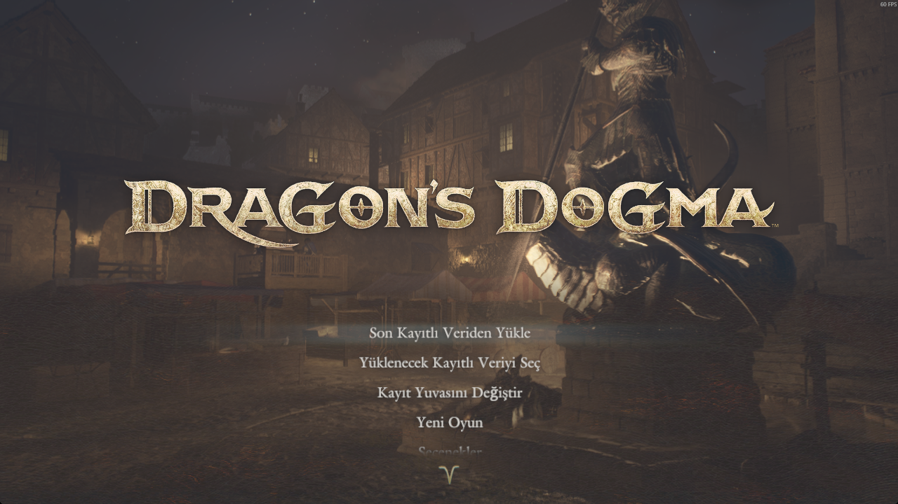
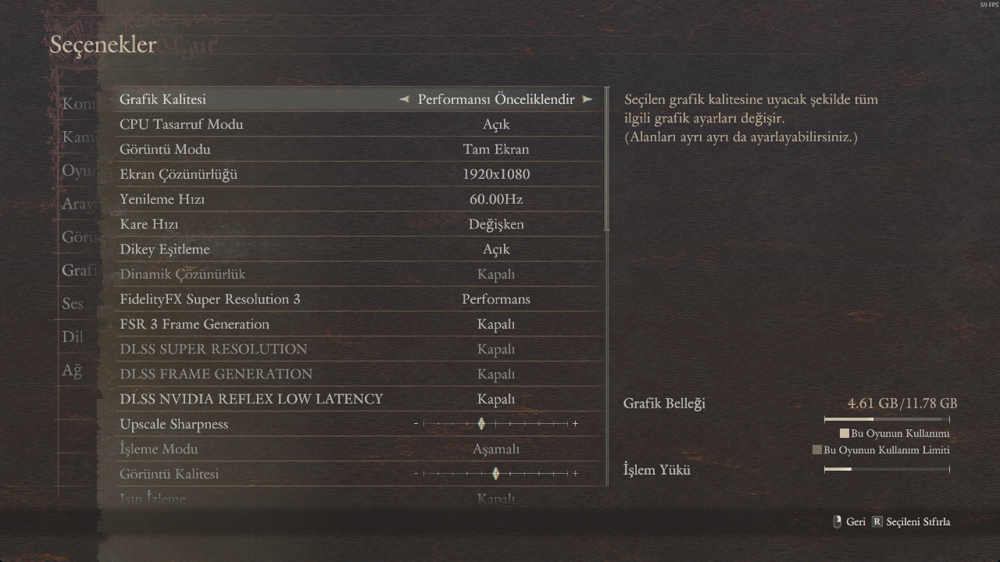
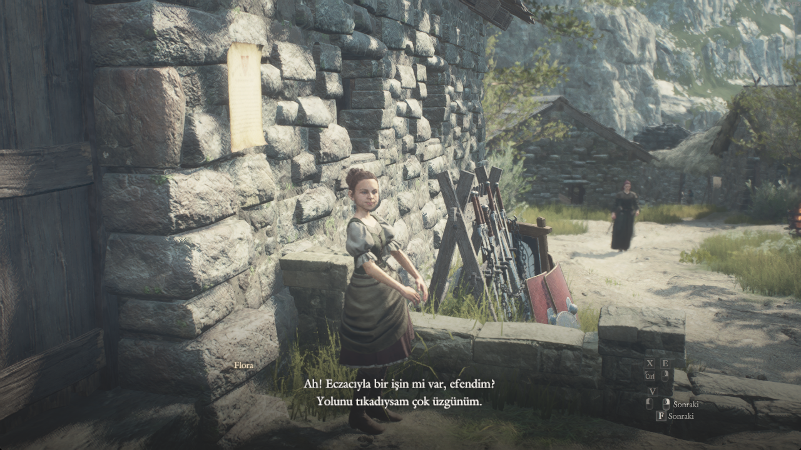

# Dragon's Dogma 2 — Türkçe Yerelleştirme (DD2-TR)

[English summary below](#english)

Açık kaynak, ücretsiz Türkçe yama projesi. Oyunun metin dosyalarını (`.msg.24`) çevirir ve mod paketi (`.pak`) olarak paketler.

> **Durum:** v1.0 — hedef oyun sürümü **4.1.0 (build 25920212, Ekim 2026)**
> **Kapsam:** Güncel oyundaki **tüm metin dosyaları (876/876)** çevrildi. Eski dosya listesindeki 198 yol artık oyunda bulunmuyor; içerikleri `_TU_END` dosyalarına taşınmış ve çevrilmiştir.
> **Çeviri:** 46.786 benzersiz dize, 43.876 satır. Yapay zekâ destekli çeviri + terim kuralları + elle düzeltmeler.

## Özellikler

- Menü, arayüz, görev metinleri, NPC/Pawn diyalogları, eşya ve beceri açıklamaları, ara sahne altyazıları
- `<lf>` satır kırma etiketleri ve tüm biçim kodları korunur
- Dragon's Dogma terimleri korunur: Arisen, Pawn, Wakestone, Ferrystone, Brine, meslek ve yer adları

## Ekran Görüntüleri

| Ana menü | Seçenekler |
|:---:|:---:|
|  |  |



## Oyuncular için kurulum

Hazır `.pak` sürümü **Nexus Mods** üzerinden yayınlanır: [DD2TR - Türkçe Yerelleştirme](https://www.nexusmods.com/dragonsdogma2/mods/1988)

Detaylı adımlar: [docs/KURULUM.md](docs/KURULUM.md)

Özet:

1. [REFramework nightly](https://github.com/praydog/REFramework-nightly) (≥ **01421**) indir, oyun klasörüne çıkar (`dinput8.dll`)
2. Oyun klasöründe `pak_mods` klasörü oluştur, `DD2TR.pak` dosyasını içine at
3. Oyunu başlat

Kaldırma: `pak_mods\DD2TR.pak` dosyasını sil.

## Geliştiriciler için derleme

Gereksinimler:

- Orijinal oyun (Steam), sürüm 4.1.0
- [REtool](https://fluffyquack.com/tools/REtool.rar) v0.241+ (FluffyQuack)
- [REMSG_Converter](https://github.com/dtlnor/REMSG_Converter) 2.0.1 (python embedded sürüm önerilir)
- [Natives Renamer](https://www.nexusmods.com/dragonsdogma2/mods/1572) içindeki `dd2.list`
- Node.js 20+

Akış:

```powershell
pwsh tools/extract_msg.ps1 -GameDir "C:\...\Dragons Dogma 2" -RETool "C:\...\REtool" -FileList "C:\...\dd2.list"

# REMSG_Converter ile: msg2txt (lang=en)  ->  *.msg.24.txt dosyaları

$env:OPENCODE_API_KEY = "..."   # OpenAI uyumlu herhangi bir sağlayıcı olur (OPENCODE_API_URL / OPENCODE_MODEL)
node tools/translate.mjs --input staging/re_chunk_000 --cache work/cache.jsonl --nothink

pwsh tools/build_pak.ps1 -NativesRoot staging/re_chunk_000 -REMSG "C:\...\REMSG_Converter" -RETool "C:\...\REtool" -OutDir .
```

## Bilinen sınırlar

- Eski listeye özgü 198 yol güncel oyunda mevcut değil (içerikleri çevrildi)
- Yapay zekâ çevirisi: bazı cümlelerde ton/terim tutarsızlığı olabilir
- Oyun güncellemeleri yamayı bozabilir; sürüm numarasına dikkat edin

## Katkı

- `data/translations.jsonl` satırları `{"s":"English","d":"Türkçe"}` biçimindedir; düzeltme PR'ları memnuniyetle karşılanır
- Çeviri yaparken `<lf>` ve `<...>` etiketlerinin **sayısı** korunmalıdır

## Krediler

- [REtool](https://fluffyquack.com/tools/REtool.rar) — FluffyQuack
- [REMSG_Converter](https://github.com/dtlnor/REMSG_Converter) — dtlnor
- [REFramework](https://github.com/praydog/REFramework) — praydog
- [Natives Renamer](https://www.nexusmods.com/dragonsdogma2/mods/1572) — Jarol
- Çeviri verisi — bu proje (CC BY-NC-SA 4.0)

## Yasal

Bu proje hayran yapımıdır, ücretsizdir ve Capcom ile bağlantılı değildir. Bu depoda **oyun dosyası bulunmaz**; yalnızca çeviri verisi, betikler ve belgeler yer alır. `Dragon's Dogma 2` ve ilgili tüm varlıklar Capcom'a aittir. Yamayı **satmayın**.

---

## English

Open-source Turkish localization for Dragon's Dogma 2. This repository contains **only** the translation memory (`data/translations.jsonl`), build scripts and documentation — **no game assets**. Target game version: 4.1.0 (build 25920212). 876/1074 message files are covered; the remaining files stayed English because their IDs changed in the latest patch. Build: REtool + REMSG_Converter + Node.js (see docs). Not affiliated with Capcom. Free, non-commercial.
